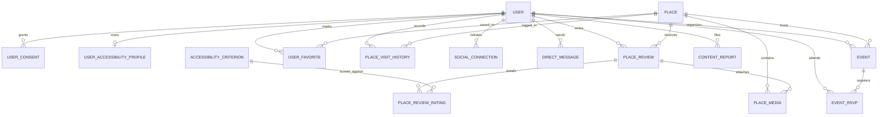
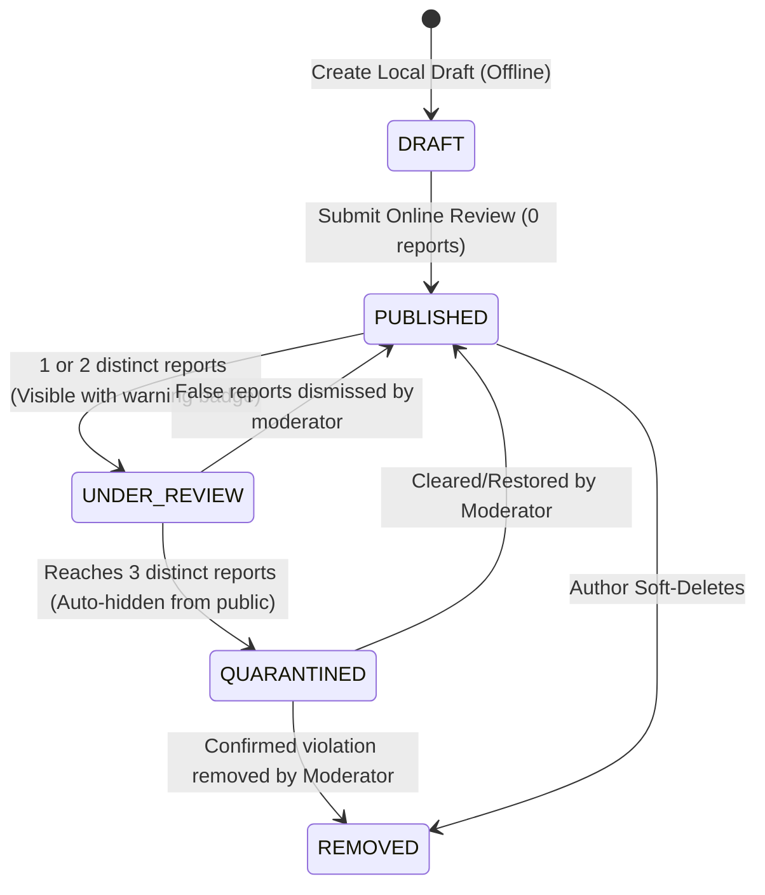
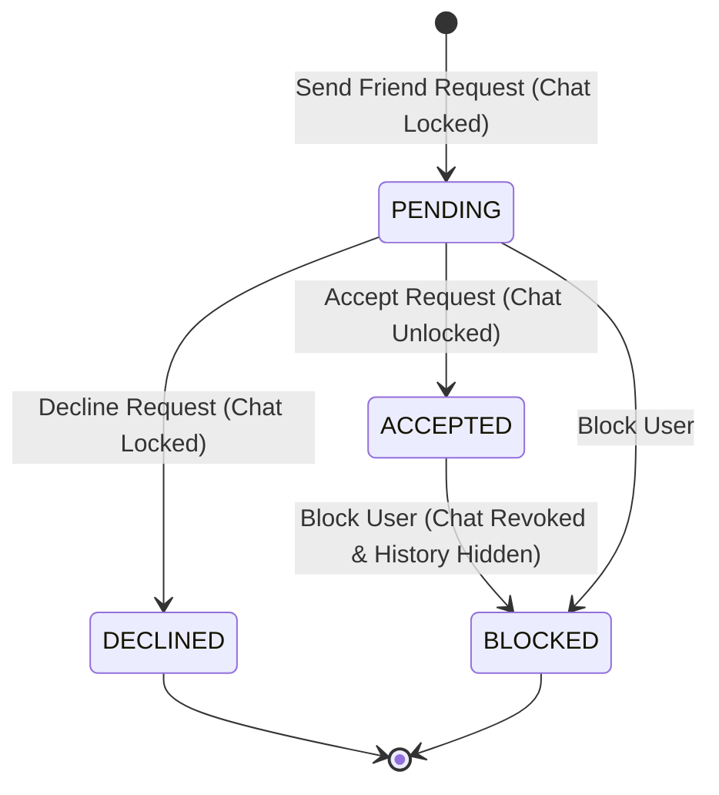

# Data Model: DáPraIr? - Plataforma Social e Avaliações de Acessibilidade Física

**Branch**: `001-acessibilidade-social-reviews`  
**Date**: 2026-11-02  
**Feature Spec**: [spec.md](./spec.md)  
**Status**: Updated post-clarifications  

---

## 1. Entity Relationship Diagram

---

## 2. Entities & Schema Definitions

### 2.1 User (`users`)
Represents an authenticated account. Contains minimal personal identifiable information (PII).

| Field | Type | Modifiers | Description |
|---|---|---|---|
| `id` | `UUID` | PK, default `gen_random_uuid()` | Unique user identifier |
| `email` | `VARCHAR(255)` | UNIQUE, NOT NULL | Account email |
| `password_hash` | `VARCHAR(255)` | NULLABLE | Argon2id hash (null for OAuth-only users) |
| `name` | `VARCHAR(100)` | NOT NULL | Display name |
| `handle` | `VARCHAR(50)` | UNIQUE, NOT NULL | Unique public handle (e.g., `@maria_silva`) |
| `avatar_url` | `VARCHAR(512)` | NULLABLE | Profile picture URL |
| `bio` | `TEXT` | NULLABLE | Optional biography |
| `role` | `VARCHAR(20)` | NOT NULL, DEFAULT `'USER'` | Enum: `USER`, `MODERATOR`, `ADMIN` |
| `badges` | `VARCHAR(50)[]` | NOT NULL, DEFAULT `{}` | Array of badges (e.g. `['VERIFIED', 'FREQUENT_REVIEWER']`) |
| `status` | `VARCHAR(20)` | NOT NULL, DEFAULT `'ACTIVE'` | Enum: `ACTIVE`, `SUSPENDED`, `DELETED` |
| `is_anonymous` | `BOOLEAN` | NOT NULL, DEFAULT `FALSE` | Set to TRUE if account has been anonymized per LGPD |
| `created_at` | `TIMESTAMPTZ` | NOT NULL, DEFAULT `NOW()` | Registration timestamp |
| `updated_at` | `TIMESTAMPTZ` | NOT NULL, DEFAULT `NOW()` | Last update timestamp |

---

### 2.2 User Consent (`user_consents`)
Audit ledger for LGPD compliance tracking explicit consent granted/revoked for personal & sensitive data.

| Field | Type | Modifiers | Description |
|---|---|---|---|
| `id` | `UUID` | PK, default `gen_random_uuid()` | Unique consent record ID |
| `user_id` | `UUID` | FK -> `users.id`, NOT NULL | User granting/revoking consent |
| `consent_type` | `VARCHAR(50)` | NOT NULL | Enum: `TERMS_OF_SERVICE`, `PRIVACY_POLICY`, `SENSITIVE_ACCESSIBILITY_DATA`, `MARKETING` |
| `version` | `VARCHAR(20)` | NOT NULL | Version of terms (e.g. `'1.0.0'`) |
| `granted` | `BOOLEAN` | NOT NULL | `TRUE` if granted, `FALSE` if revoked |
| `granted_at` | `TIMESTAMPTZ` | NOT NULL, DEFAULT `NOW()` | Timestamp of action |
| `ip_address_hash`| `VARCHAR(64)` | NOT NULL | SHA-256 hash of IP address (pseudonymized) |
| `user_agent` | `VARCHAR(255)` | NULLABLE | Browser or app user agent string |

---

### 2.3 User Accessibility Profile (`user_accessibility_profiles`)
Stores sensitive health and disability preferences (Art. 5º, II da LGPD) with granular privacy control.

| Field | Type | Modifiers | Description |
|---|---|---|---|
| `id` | `UUID` | PK, default `gen_random_uuid()` | Profile record ID |
| `user_id` | `UUID` | FK -> `users.id`, UNIQUE, NOT NULL | Owning user |
| `disability_types`| `VARCHAR(50)[]` | NOT NULL, DEFAULT `{}` | e.g. `['WHEELCHAIR_MANUAL', 'WHEELCHAIR_POWERED', 'REDUCED_MOBILITY', 'PROSTHESIS']` |
| `assistance_needs`| `VARCHAR(50)[]` | NOT NULL, DEFAULT `{}` | e.g. `['RAMP_REQUIRED', 'ELEVATOR_REQUIRED', 'ADAPTED_RESTROOM', 'WIDE_DOORS']` |
| `visibility` | `VARCHAR(20)` | NOT NULL, DEFAULT `'PRIVATE'` | Enum: `PUBLIC`, `FRIENDS_ONLY`, `PRIVATE` |
| `encrypted_payload`| `BYTEA` | NULLABLE | AES-256-GCM encrypted backup of sensitive preferences when visibility is private |
| `created_at` | `TIMESTAMPTZ` | NOT NULL, DEFAULT `NOW()` | Record created |
| `updated_at` | `TIMESTAMPTZ` | NOT NULL, DEFAULT `NOW()` | Record updated |

---

### 2.4 Place (`places`)
Represents physical locations (establishments, venues, parks, public buildings). Supports hybrid discovery (Google Places + Crowdsourcing).

| Field | Type | Modifiers | Description |
|---|---|---|---|
| `id` | `UUID` | PK, default `gen_random_uuid()` | Unique place identifier |
| `google_place_id` | `VARCHAR(128)` | UNIQUE, NULLABLE | Google Places API unique identifier (for cached places) |
| `source` | `VARCHAR(20)` | NOT NULL, DEFAULT `'COMMUNITY'` | Enum: `COMMUNITY`, `GOOGLE_PLACES` |
| `name` | `VARCHAR(200)` | NOT NULL | Name of the venue |
| `description` | `TEXT` | NULLABLE | Description of the venue |
| `category` | `VARCHAR(50)` | NOT NULL | Enum: `RESTAURANT`, `BAR`, `SHOPPING`, `PARK`, `HOTEL`, `HOSPITAL`, `EDUCATION`, `PUBLIC_AGENCY`, `OTHER` |
| `address` | `VARCHAR(300)` | NOT NULL | Full formatted address |
| `city` | `VARCHAR(100)` | NOT NULL | City name |
| `state` | `VARCHAR(50)` | NOT NULL | State code / UF |
| `postal_code` | `VARCHAR(20)` | NULLABLE | CEP / Zip code |
| `coordinates` | `GEOGRAPHY(Point, 4326)` | NOT NULL | PostGIS spatial point (Longitude, Latitude) |
| `overall_score`| `NUMERIC(3,2)` | NOT NULL, DEFAULT `0.00` | Aggregate accessibility score (1.00 to 5.00) |
| `total_reviews`| `INTEGER` | NOT NULL, DEFAULT `0` | Total number of published reviews |
| `last_reviewed_at`| `TIMESTAMPTZ` | NULLABLE | Date of most recent review |
| `created_at` | `TIMESTAMPTZ` | NOT NULL, DEFAULT `NOW()` | Place record creation |
| `updated_at` | `TIMESTAMPTZ` | NOT NULL, DEFAULT `NOW()` | Place record update |

*Spatial Index*: `CREATE INDEX idx_places_coordinates ON places USING GIST (coordinates);`  
*External ID Index*: `CREATE INDEX idx_places_google_place_id ON places (google_place_id);`

---

### 2.5 Accessibility Criterion (`accessibility_criteria`)
Standardized catalog of physical accessibility evaluation criteria.

| Field | Type | Modifiers | Description |
|---|---|---|---|
| `id` | `UUID` | PK, default `gen_random_uuid()` | Unique criterion identifier |
| `code` | `VARCHAR(50)` | UNIQUE, NOT NULL | Code: `ENTRANCE_RAMP_LEVEL`, `ELEVATOR_LIFT`, `ADAPTED_BATHROOM`, `MANEUVERING_SPACE`, `ADAPTED_SEATING`, `ACCESSIBLE_PARKING`, `INCLUSIVE_SERVICE` |
| `title` | `VARCHAR(100)` | NOT NULL | Title (e.g., "Entrada com Rampa ou Nivelada") |
| `description` | `TEXT` | NOT NULL | Guidance text for evaluator |
| `icon_name` | `VARCHAR(50)` | NOT NULL | Icon identifier for UI rendering |
| `weight` | `NUMERIC(3,2)` | NOT NULL, DEFAULT `1.00` | Weight in overall score formula |
| `is_active` | `BOOLEAN` | NOT NULL, DEFAULT `TRUE` | Active status in evaluation forms |

---

### 2.6 Place Review (`place_reviews`)
Accessibility review created by a user for a specific place. Tracks reports and threshold status.

| Field | Type | Modifiers | Description |
|---|---|---|---|
| `id` | `UUID` | PK, default `gen_random_uuid()` | Review identifier |
| `place_id` | `UUID` | FK -> `places.id`, NOT NULL | Reviewed place |
| `user_id` | `UUID` | FK -> `users.id`, NOT NULL | Author of the review |
| `general_comment`| `TEXT` | NULLABLE | User remarks and context |
| `average_score`| `NUMERIC(3,2)` | NOT NULL | Calculated mean of criteria scores in this review |
| `report_count` | `INTEGER` | NOT NULL, DEFAULT `0` | Number of distinct user reports against this review |
| `status` | `VARCHAR(20)` | NOT NULL, DEFAULT `'PUBLISHED'` | Enum: `DRAFT`, `PUBLISHED`, `UNDER_REVIEW` (1-2 reports), `QUARANTINED` (>=3 reports), `REMOVED` |
| `created_at` | `TIMESTAMPTZ` | NOT NULL, DEFAULT `NOW()` | Publication date |
| `updated_at` | `TIMESTAMPTZ` | NOT NULL, DEFAULT `NOW()` | Last edit date |

---

### 2.7 Place Review Rating Item (`place_review_ratings`)
Quantitative score (1-5) for an individual accessibility criterion within a review.

| Field | Type | Modifiers | Description |
|---|---|---|---|
| `id` | `UUID` | PK, default `gen_random_uuid()` | Unique score record ID |
| `review_id` | `UUID` | FK -> `place_reviews.id`, NOT NULL | Parent review |
| `criterion_id` | `UUID` | FK -> `accessibility_criteria.id`, NOT NULL | Evaluated criterion |
| `score` | `SMALLINT` | NOT NULL, CHECK (`score >= 1 AND score <= 5`) | Integer rating (1 to 5) |
| `notes` | `TEXT` | NULLABLE | Specific observations on this criterion |

*Constraint*: `UNIQUE (review_id, criterion_id)`

---

### 2.8 Place Media (`place_media`)
Photos and evidence uploaded with reviews or places, with mandatory accessibility descriptions and report tracking.

| Field | Type | Modifiers | Description |
|---|---|---|---|
| `id` | `UUID` | PK, default `gen_random_uuid()` | Media record ID |
| `place_id` | `UUID` | FK -> `places.id`, NOT NULL | Place referenced |
| `review_id` | `UUID` | FK -> `place_reviews.id`, NULLABLE | Associated review |
| `user_id` | `UUID` | FK -> `users.id`, NOT NULL | Uploader |
| `media_url` | `VARCHAR(512)` | NOT NULL | CDN / Storage URL |
| `thumbnail_url`| `VARCHAR(512)` | NOT NULL | Optimized thumbnail URL |
| `alt_text` | `VARCHAR(300)` | NOT NULL | Screen-reader mandatory description (AR-001) |
| `mime_type` | `VARCHAR(50)` | NOT NULL | e.g. `'image/webp'`, `'image/jpeg'` |
| `size_bytes` | `INTEGER` | NOT NULL | File size in bytes |
| `report_count` | `INTEGER` | NOT NULL, DEFAULT `0` | Number of reports against this media |
| `status` | `VARCHAR(20)` | NOT NULL, DEFAULT `'ACTIVE'` | Enum: `ACTIVE`, `UNDER_REVIEW`, `QUARANTINED`, `REMOVED` |
| `created_at` | `TIMESTAMPTZ` | NOT NULL, DEFAULT `NOW()` | Upload date |

---

### 2.9 Social Connection (`social_connections`)
Represents relationships and friendships between users. Acts as the authorization barrier for 1:1 chat.

| Field | Type | Modifiers | Description |
|---|---|---|---|
| `id` | `UUID` | PK, default `gen_random_uuid()` | Connection ID |
| `requester_id` | `UUID` | FK -> `users.id`, NOT NULL | User who initiated connection |
| `addressee_id` | `UUID` | FK -> `users.id`, NOT NULL | Target user |
| `status` | `VARCHAR(20)` | NOT NULL, DEFAULT `'PENDING'` | Enum: `PENDING`, `ACCEPTED`, `DECLINED`, `BLOCKED` |
| `created_at` | `TIMESTAMPTZ` | NOT NULL, DEFAULT `NOW()` | Request sent timestamp |
| `updated_at` | `TIMESTAMPTZ` | NOT NULL, DEFAULT `NOW()` | Status transition timestamp |

*Constraint*: `UNIQUE (requester_id, addressee_id)`

---

### 2.10 Direct Message (`direct_messages`)
One-on-one text communication between connected peers.

| Field | Type | Modifiers | Description |
|---|---|---|---|
| `id` | `UUID` | PK, default `gen_random_uuid()` | Message identifier |
| `sender_id` | `UUID` | FK -> `users.id`, NOT NULL | Message sender |
| `recipient_id` | `UUID` | FK -> `users.id`, NOT NULL | Message recipient |
| `content` | `TEXT` | NOT NULL | Message content (max 2000 chars) |
| `status` | `VARCHAR(20)` | NOT NULL, DEFAULT `'SENT'` | Enum: `SENT`, `DELIVERED`, `READ` |
| `read_at` | `TIMESTAMPTZ` | NULLABLE | Timestamp when read |
| `created_at` | `TIMESTAMPTZ` | NOT NULL, DEFAULT `NOW()` | Dispatch timestamp |

*Security Invariant*: Insert permitted ONLY IF a mutual record in `social_connections` exists with `status == 'ACCEPTED'` between `sender_id` and `recipient_id`.

---

### 2.11 Event (`events`)
Community events, meetups, and inclusive gatherings with mandatory accessibility disclosures.

| Field | Type | Modifiers | Description |
|---|---|---|---|
| `id` | `UUID` | PK, default `gen_random_uuid()` | Event identifier |
| `creator_id` | `UUID` | FK -> `users.id`, NOT NULL | Event organizer |
| `place_id` | `UUID` | FK -> `places.id`, NULLABLE | Associated place if known |
| `title` | `VARCHAR(150)` | NOT NULL | Event title |
| `description` | `TEXT` | NOT NULL | Full event description |
| `start_time` | `TIMESTAMPTZ` | NOT NULL | Event start date & time |
| `end_time` | `TIMESTAMPTZ` | NOT NULL | Event end date & time |
| `location_name`| `VARCHAR(200)` | NOT NULL | Venue name / location string |
| `address` | `VARCHAR(300)` | NOT NULL | Physical address |
| `coordinates` | `GEOGRAPHY(Point, 4326)` | NULLABLE | Spatial coordinate for mapping |
| `accessibility_checklist`| `JSONB` | NOT NULL | Declared accessibility features (mandatory per FR-017) |
| `max_attendees`| `INTEGER` | NULLABLE | Maximum capacity (null for unlimited) |
| `status` | `VARCHAR(20)` | NOT NULL, DEFAULT `'SCHEDULED'` | Enum: `SCHEDULED`, `CANCELLED`, `COMPLETED` |
| `created_at` | `TIMESTAMPTZ` | NOT NULL, DEFAULT `NOW()` | Creation date |
| `updated_at` | `TIMESTAMPTZ` | NOT NULL, DEFAULT `NOW()` | Update date |

---

### 2.12 Event RSVP (`event_rsvps`)
Tracks user attendance for events.

| Field | Type | Modifiers | Description |
|---|---|---|---|
| `id` | `UUID` | PK, default `gen_random_uuid()` | RSVP record ID |
| `event_id` | `UUID` | FK -> `events.id`, NOT NULL | Event ID |
| `user_id` | `UUID` | FK -> `users.id`, NOT NULL | Attendee ID |
| `status` | `VARCHAR(20)` | NOT NULL, DEFAULT `'CONFIRMED'` | Enum: `CONFIRMED`, `DECLINED`, `WAITLIST` |
| `created_at` | `TIMESTAMPTZ` | NOT NULL, DEFAULT `NOW()` | RSVP timestamp |

---

### 2.13 Content Report (`content_reports`)
User moderation reports against abusive or inaccurate content. Drives the automatic quarantine threshold.

| Field | Type | Modifiers | Description |
|---|---|---|---|
| `id` | `UUID` | PK, default `gen_random_uuid()` | Report record ID |
| `reporter_id` | `UUID` | FK -> `users.id`, NOT NULL | User reporting |
| `target_type` | `VARCHAR(30)` | NOT NULL | Enum: `REVIEW`, `MESSAGE`, `USER`, `EVENT`, `MEDIA` |
| `target_id` | `UUID` | NOT NULL | Identifier of the reported object |
| `reason` | `VARCHAR(50)` | NOT NULL | Enum: `INACCURATE_DATA`, `INAPPROPRIATE_MEDIA`, `HARASSMENT`, `SPAM`, `OTHER` |
| `details` | `TEXT` | NULLABLE | Detailed explanation by reporter |
| `status` | `VARCHAR(20)` | NOT NULL, DEFAULT `'PENDING'` | Enum: `PENDING`, `IN_REVIEW`, `RESOLVED`, `DISMISSED` |
| `resolved_by` | `UUID` | FK -> `users.id`, NULLABLE | Moderator who handled the case |
| `resolution_notes`| `TEXT` | NULLABLE | Moderator notes |
| `created_at` | `TIMESTAMPTZ` | NOT NULL, DEFAULT `NOW()` | Report creation |
| `resolved_at` | `TIMESTAMPTZ` | NULLABLE | Resolution timestamp |

---

### 2.14 User Favorite (`user_favorites`) & Visit History (`place_visit_history`)
Saved places and visits for fast offline access and personal logging.

- `user_favorites`: `(user_id, place_id, created_at)`
- `place_visit_history`: `(id, user_id, place_id, visited_at)`

---

## 3. State Transitions & Quarantine Lifecycle

### 3.1 Place Review Quarantine Lifecycle

### 3.2 Social Connection Lifecycle & Chat Barrier

