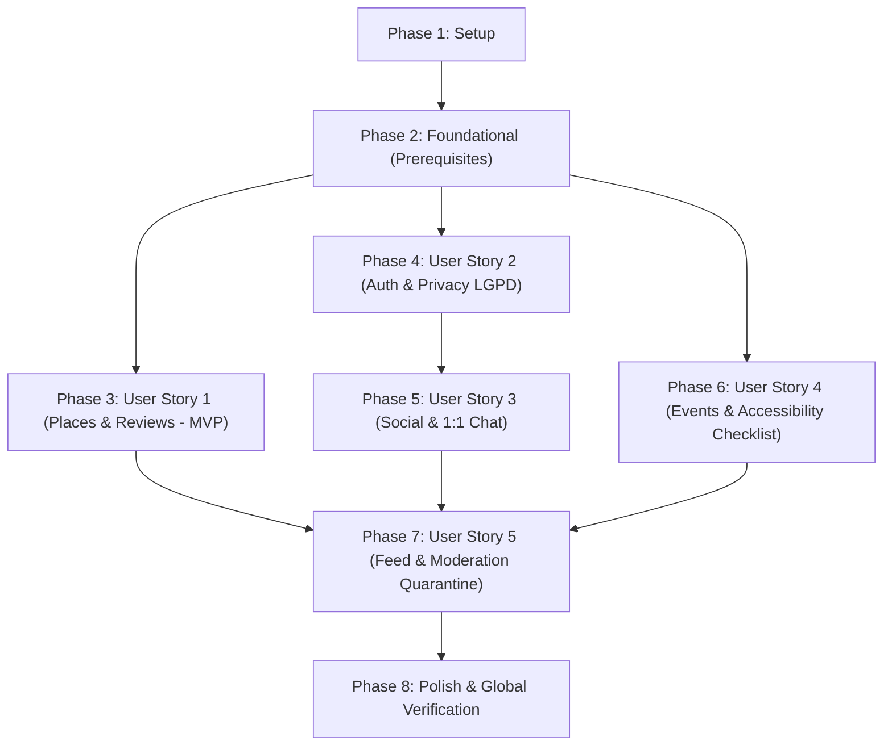

# Tasks: DáPraIr? - Plataforma Social e Avaliações de Acessibilidade Física

**Input**: Design documents from `/specs/001-acessibilidade-social-reviews/` (`plan.md`, `spec.md`, `data-model.md`, `research.md`, `quickstart.md`, `contracts/openapi.yaml`)  
**Prerequisites**: plan.md (required), spec.md (required for user stories), research.md, data-model.md, contracts/  

**Tests**: Tests are MANDATORY per Constitution (Principle III: Testabilidade Contínua e Alta Cobertura >= 80%). Every story includes unit tests, widget/accessibility tests, and integration/contract tests.

**Organization**: Tasks are grouped by user story to enable independent implementation and testing of each story.

## Format: `[ID] [P?] [Story] Description`

- **[P]**: Can run in parallel (different files, no dependencies)
- **[Story]**: Which user story this task belongs to (`[US1]`, `[US2]`, `[US3]`, `[US4]`, `[US5]`)
- Include exact file paths in descriptions

## Path Conventions

- **Monorepo**:
  - Backend (Fastify + TypeScript + Prisma + PostGIS): `backend/`
  - Frontend (Flutter 3.24+ Multiplataforma): `frontend/`
  - Infraestrutura (Docker + PostGIS + MinIO): `docker-compose.yml`

---

## Phase 1: Setup (Shared Infrastructure)

**Purpose**: Project initialization, directory structure, container orchestration, and shared dev tooling.

- [ ] T001 Create root container orchestration for PostgreSQL 16 with PostGIS and MinIO in docker-compose.yml
- [ ] T002 Initialize Fastify TypeScript backend project structure and package dependencies in backend/package.json and backend/tsconfig.json
- [ ] T003 [P] Configure backend environment schema validation using Zod in backend/src/config.ts and backend/.env.example
- [ ] T004 [P] Initialize Flutter 3.24+ project configuration with dependencies (flutter_bloc, drift, dio, flutter_map, geolocator, url_launcher) in frontend/pubspec.yaml and frontend/analysis_options.yaml
- [ ] T005 [P] Configure Vitest and code coverage thresholds (>= 80%) in backend/vitest.config.ts

---

## Phase 2: Foundational (Blocking Prerequisites)

**Purpose**: Core infrastructure, database schemas, cryptographic primitives, and accessible design system that MUST be complete before ANY user story can begin.

**⚠️ CRITICAL**: No user story work can begin until this phase is complete.

- [ ] T006 Define Prisma relational schema with PostGIS spatial geography, user consents, profiles, places, reviews, social connections, events, and reports in backend/prisma/schema.prisma
- [ ] T007 Create initial database migration with PostGIS GiST index extensions and seed 7 standardized accessibility criteria in backend/prisma/seed.ts
- [ ] T008 [P] Implement base application error hierarchy and Fastify sensible error plugin in backend/src/core/errors/app-error.ts and backend/src/core/plugins/sensible.ts
- [ ] T009 [P] Implement cryptographic security service with Argon2id password hashing and AES-256-GCM encryption for LGPD sensitive data in backend/src/core/crypto/encryption.ts
- [ ] T010 [P] Implement MinIO/S3 object storage client with Sharp image processing for photo attachments in backend/src/core/storage/s3-client.ts
- [ ] T011 Implement Fastify server bootstrap with CORS, Swagger OpenAPI documentation, JWT authentication, and WebSocket support in backend/src/server.ts and backend/src/core/plugins/jwt.ts
- [ ] T012 [P] Implement Flutter accessible Design System with WCAG 2.1 AA/AAA contrast, Alto Contraste theme, and scalable typography in frontend/lib/core/theme/app_theme.dart, frontend/lib/core/theme/app_colors.dart, and frontend/lib/core/theme/app_typography.dart
- [ ] T013 [P] Create accessible UI base components (min touch target 48x48 dp, Semantic labels, focus management) in frontend/lib/presentation/components/accessible_button.dart, frontend/lib/presentation/components/accessible_text_field.dart, and frontend/lib/presentation/components/accessible_card.dart
- [ ] T014 [P] Implement Dio network client with JWT token refresh interceptor and offline error handling in frontend/lib/core/network/dio_client.dart and frontend/lib/core/network/auth_interceptor.dart
- [ ] T015 [P] Setup Drift local SQLite database schema for offline cache and review drafts in frontend/lib/data/local/app_database.dart
- [ ] T016 [P] Implement accessibility semantics helper and screen reader announcement utilities in frontend/lib/core/accessibility/semantics_helper.dart

**Checkpoint**: Foundation ready - user story implementation can now begin.

---

## Phase 3: User Story 1 - Descoberta e Avaliação Detalhada de Acessibilidade de Locais (Priority: P1) 🎯 MVP

**Goal**: Permitir que qualquer usuário (incluindo visitantes no Modo Convidado) busque locais no mapa/lista por GPS ou endereço digitado com filtros de acessibilidade, consulte detalhes e notas dos 7 critérios, visualize fotos com audiodescrição, e que usuários autenticados cadastrem locais comunitariamente ou enviem avaliações multicritério com fotos, contando com suporte a rascunhos offline e delegação de rotas externas.

**Independent Test**: Navegar pelo mapa sem login em Modo Convidado aplicando filtros de acessibilidade ("Banheiro Adaptado" e "Rampa"), abrir a tela de detalhes de um local, verificar médias por critério e alerta de 12 meses; autenticar-se, criar rascunho offline em modo avião, reconectar, anexar foto com alt_text obrigatório e submeter a avaliação com notas de 1 a 5, validando a atualização imediata das médias do local e o acionamento de deeplink para o Google Maps/Waze.

### Tests for User Story 1 (MANDATORY - >= 80% coverage + Accessibility) ⚠️

- [ ] T017 [P] [US1] Integration tests for spatial places search, accessibility filters, and Google Places hybrid fallback in backend/tests/integration/places.test.ts
- [ ] T018 [P] [US1] Integration tests for multicriteria review creation, score calculation, 12-month review warning, and photo upload with mandatory alt_text in backend/tests/integration/reviews.test.ts
- [ ] T019 [P] [US1] Accessibility & widget tests verifying semantics tree, screen reader labels, and >= 48dp targets on place card components in frontend/test/widgets/place_card_semantics_test.dart
- [ ] T020 [P] [US1] Widget test verifying accessible multicriteria review form with 7 criteria ratings and mandatory photo alt_text in frontend/test/widgets/review_form_widget_test.dart
- [ ] T021 [P] [US1] Unit and BLoC tests for hybrid places search, guest mode queries, and review submission in frontend/test/unit/places_bloc_test.dart

### Implementation for User Story 1

- [ ] T022 [P] [US1] Implement PostGIS spatial queries, Google Places API integration, and crowdsourced venue creation in backend/src/modules/places/places.service.ts
- [ ] T023 [US1] Implement public and authenticated places REST routes (GET /places, POST /places, GET /places/:placeId, GET /places/external-search) in backend/src/modules/places/places.routes.ts
- [ ] T024 [P] [US1] Implement multicriteria reviews calculation engine, ratings persistence, and 12-month verification check in backend/src/modules/reviews/reviews.service.ts
- [ ] T025 [US1] Implement reviews REST routes (POST /places/:placeId/reviews, GET /places/:placeId/reviews) in backend/src/modules/reviews/reviews.routes.ts
- [ ] T026 [P] [US1] Implement media upload service with Sharp optimization and mandatory alt_text validation in backend/src/modules/media/media.service.ts and backend/src/modules/media/media.routes.ts
- [ ] T027 [P] [US1] Create Place and Review domain entities and repository interfaces in frontend/lib/domain/entities/place.dart, frontend/lib/domain/entities/review.dart, and frontend/lib/domain/repositories/places_repository.dart
- [ ] T028 [P] [US1] Implement PlacesRepository with Dio remote API, Drift local caching, and offline draft storage in frontend/lib/data/repositories/places_repository_impl.dart and frontend/lib/data/local/places_dao.dart
- [ ] T029 [P] [US1] Implement external navigation deeplink launcher (Google Maps, Waze, Apple Maps) via url_launcher in frontend/lib/core/navigation/external_navigation_launcher.dart
- [ ] T030 [US1] Implement PlacesBloc and ReviewsBloc state management with guest mode support in frontend/lib/presentation/bloc/places/places_bloc.dart and frontend/lib/presentation/bloc/reviews/reviews_bloc.dart
- [ ] T031 [US1] Build accessible Map & Search screen with flutter_map, GPS locator, address text search, and accessibility criteria filter chips in frontend/lib/presentation/views/map_search/map_search_screen.dart
- [ ] T032 [US1] Build Place Details screen with score breakdown for 7 criteria, audiodescribed photo gallery, 12-month outdated warning badge, and external route launcher in frontend/lib/presentation/views/place/place_detail_screen.dart
- [ ] T033 [US1] Build Submit Review screen with accessible 1-5 rating sliders/radios for 7 criteria, photo picker with mandatory alt_text input, and offline draft indicator in frontend/lib/presentation/views/place/submit_review_screen.dart
- [ ] T034 [US1] Build accessible Guest Action modal dialog prompting non-authenticated visitors to log in when attempting write actions in frontend/lib/presentation/components/guest_action_dialog.dart

**Checkpoint**: User Story 1 (MVP) is fully functional and independently testable across backend and frontend!

---

## Phase 4: User Story 2 - Cadastro Inclusivo, Perfil e Gestão Granular de Privacidade (Priority: P1)

**Goal**: Oferecer fluxo de registro inclusivo (e-mail/senha e OAuth), onboarding com tipos de deficiência e preferências de acessibilidade opcionais, gestão estrita de privacidade e LGPD com consentimento explícito auditado, criptografia de dados sensíveis, controle de visibilidade (`PUBLIC`, `FRIENDS_ONLY`, `PRIVATE`), portabilidade de dados e anonimização/esquecimento.

**Independent Test**: Realizar onboarding de um novo usuário configurando deficiência com visibilidade "Apenas Amigos" ou "Privado"; autenticar com usuário desconhecido e verificar que dados sensíveis não são retornados no perfil público; acionar exportação de dados em JSON e solicitar anonimização da conta via endpoint e UI, validando pseudonimização no banco de dados.

### Tests for User Story 2 (MANDATORY - >= 80% coverage + Accessibility) ⚠️

- [ ] T035 [P] [US2] Integration tests for registration, Argon2id password hashing, JWT issue, and login in backend/tests/integration/auth.test.ts
- [ ] T036 [P] [US2] Integration tests for LGPD consent ledger, AES-256 encrypted sensitive profile, visibility rules, data export, and account anonymization in backend/tests/integration/privacy_lgpd.test.ts
- [ ] T037 [P] [US2] Widget and accessibility tests for onboarding forms with screen reader navigation and accessible form fields in frontend/test/widgets/accessibility_profile_form_test.dart
- [ ] T038 [P] [US2] Unit and BLoC tests for user registration, accessibility profile updates, and privacy controls in frontend/test/unit/auth_profile_bloc_test.dart

### Implementation for User Story 2

- [ ] T039 [P] [US2] Implement user authentication service with JWT token issuance and Argon2id verification in backend/src/modules/auth/auth.service.ts
- [ ] T040 [US2] Implement authentication REST routes (POST /auth/register, POST /auth/login) in backend/src/modules/auth/auth.routes.ts
- [ ] T041 [P] [US2] Implement user accessibility profile service with AES-256 encrypted payload and field-level visibility filtering (PUBLIC, FRIENDS_ONLY, PRIVATE) in backend/src/modules/users/users.service.ts
- [ ] T042 [P] [US2] Implement LGPD privacy service with consent audit recording, JSON data export for portability, and account anonymization in backend/src/modules/users/privacy.service.ts
- [ ] T043 [US2] Implement user profile and privacy REST routes (GET/PUT /users/me/accessibility-profile, GET /users/me/export-data, DELETE /users/me/anonymize) in backend/src/modules/users/users.routes.ts
- [ ] T044 [P] [US2] Create User, AccessibilityProfile, and Consent domain entities in frontend/lib/domain/entities/user_profile.dart and frontend/lib/domain/entities/accessibility_profile.dart
- [ ] T045 [P] [US2] Implement AuthRepository and UserRepository with token storage and profile synchronization in frontend/lib/data/repositories/auth_repository_impl.dart and frontend/lib/data/repositories/user_repository_impl.dart
- [ ] T046 [US2] Implement AuthBloc and ProfileBloc state management in frontend/lib/presentation/bloc/auth/auth_bloc.dart and frontend/lib/presentation/bloc/profile/profile_bloc.dart
- [ ] T047 [US2] Build accessible Login and Register screens with high-contrast text and TalkBack/VoiceOver labels in frontend/lib/presentation/views/auth/login_screen.dart and frontend/lib/presentation/views/auth/register_screen.dart
- [ ] T048 [US2] Build Onboarding Accessibility screen with optional disability types, assistance needs, and explicit LGPD consent notices in frontend/lib/presentation/views/auth/onboarding_accessibility_screen.dart
- [ ] T049 [US2] Build Profile & Privacy Settings screen with field-level visibility toggles, data export download trigger, and account deletion confirmation in frontend/lib/presentation/views/profile/profile_privacy_settings_screen.dart

**Checkpoint**: User Stories 1 and 2 are fully integrated and independently functional.

---

## Phase 5: User Story 3 - Conexões Sociais e Comunicação Direta entre Pares (Priority: P2)

**Goal**: Permitir que usuários encontrem pares com interesses e necessidades de acessibilidade compatíveis, enviem e gerenciem solicitações de amizade, e se comuniquem através de chat direto 1:1 estritamente restrito a amigos aceitos (barreira de autorização contra spam e assédio), com opção de bloqueio imediato.

**Independent Test**: Usuário A envia solicitação de amizade para Usuário B; verificar que antes do aceite qualquer tentativa de envio de mensagem retorna erro de autorização (403); após o aceite de B, enviar mensagem de texto via WebSocket e verificar entrega instantânea; acionar bloqueio de usuário e validar cessação imediata do canal de conversa.

### Tests for User Story 3 (MANDATORY - >= 80% coverage + Accessibility) ⚠️

- [ ] T050 [P] [US3] Integration tests for social recommendations, connection requests, acceptance, and blocking transitions in backend/tests/integration/social.test.ts
- [ ] T051 [P] [US3] Integration and security tests for 1:1 chat barrier (verifying non-friends cannot send messages), message delivery, and blocking in backend/tests/integration/chat.test.ts
- [ ] T052 [P] [US3] Widget tests for chat conversation view verifying semantic message reading order, live region announcements, and >= 48dp action buttons in frontend/test/widgets/chat_message_list_test.dart
- [ ] T053 [P] [US3] Unit and BLoC tests for friendship connections and real-time chat state management in frontend/test/unit/social_chat_bloc_test.dart

### Implementation for User Story 3

- [ ] T054 [P] [US3] Implement social connections service with affinity recommendation algorithm based on public accessibility preferences and connection state machine in backend/src/modules/social/social.service.ts
- [ ] T055 [US3] Implement social connections REST routes (GET /social/recommendations, POST /social/connections, PATCH /social/connections/:id) in backend/src/modules/social/social.routes.ts
- [ ] T056 [P] [US3] Implement 1:1 direct messaging service with strict accepted-friendship authorization check, rate-limiting, and message history in backend/src/modules/chat/chat.service.ts
- [ ] T057 [US3] Implement chat REST routes (GET /chat/messages/:peerUserId, POST /chat/messages/:peerUserId) and real-time WebSocket connection handler in backend/src/modules/chat/chat.routes.ts and backend/src/modules/chat/chat.websocket.ts
- [ ] T058 [P] [US3] Create SocialConnection and DirectMessage domain entities and repository interfaces in frontend/lib/domain/entities/social_connection.dart and frontend/lib/domain/entities/chat_message.dart
- [ ] T059 [P] [US3] Implement SocialRepository and ChatRepository with WebSocket streaming and local message persistence in frontend/lib/data/repositories/social_repository_impl.dart and frontend/lib/data/repositories/chat_repository_impl.dart
- [ ] T060 [US3] Implement SocialBloc and ChatBloc state management in frontend/lib/presentation/bloc/social/social_bloc.dart and frontend/lib/presentation/bloc/chat/chat_bloc.dart
- [ ] T061 [US3] Build Social & Friends screen with peer suggestions, pending requests tab, and friend list in frontend/lib/presentation/views/social/social_connections_screen.dart
- [ ] T062 [US3] Build accessible 1:1 Chat Conversation screen with live message announcements, message input with clear labeling, and accessible block/report actions in frontend/lib/presentation/views/social/chat_conversation_screen.dart

**Checkpoint**: User Stories 1, 2, and 3 work independently and seamlessly together.

---

## Phase 6: User Story 4 - Descoberta e Divulgação de Eventos Inclusivos (Priority: P2)

**Goal**: Permitir que organizadores publiquem encontros comunitários com declaração obrigatória de checklist de acessibilidade física do local, e que membros da comunidade descubram eventos por proximidade e filtros de acessibilidade, confirmando presença (RSVP).

**Independent Test**: Criar um evento declarando itens de acessibilidade obrigatórios (rampa, banheiro adaptado, vagas); validar que o evento é rejeitado se o checklist estiver incompleto; buscar eventos aplicando filtros, confirmar presença com outro usuário (RSVP) e validar a listagem de participantes confirmados.

### Tests for User Story 4 (MANDATORY - >= 80% coverage + Accessibility) ⚠️

- [ ] T063 [P] [US4] Integration tests for event creation with mandatory accessibility checklist validation, event filtering by date/accessibility, and RSVP registration in backend/tests/integration/events.test.ts
- [ ] T064 [P] [US4] Widget and accessibility tests for event card and RSVP button with semantic states in frontend/test/widgets/event_card_semantics_test.dart
- [ ] T065 [P] [US4] Unit and BLoC tests for event discovery, checklist validation, and RSVP actions in frontend/test/unit/events_bloc_test.dart

### Implementation for User Story 4

- [ ] T066 [P] [US4] Implement events service with mandatory accessibility checklist validation (FR-017), spatial filtering, and RSVP management in backend/src/modules/events/events.service.ts
- [ ] T067 [US4] Implement events REST routes (GET /events, POST /events, POST /events/:eventId/rsvp) in backend/src/modules/events/events.routes.ts
- [ ] T068 [P] [US4] Create Event and EventRSVP domain entities and repository interfaces in frontend/lib/domain/entities/event.dart and frontend/lib/domain/repositories/events_repository.dart
- [ ] T069 [P] [US4] Implement EventsRepository with remote Dio client and Drift offline caching in frontend/lib/data/repositories/events_repository_impl.dart
- [ ] T070 [US4] Implement EventsBloc state management in frontend/lib/presentation/bloc/events/events_bloc.dart
- [ ] T071 [US4] Build Events List and Discovery screen with accessibility filter chips, date selector, and event cards in frontend/lib/presentation/views/events/events_list_screen.dart
- [ ] T072 [US4] Build Create Event screen with required fields and mandatory accessibility conditions checklist in frontend/lib/presentation/views/events/create_event_screen.dart
- [ ] T073 [US4] Build Event Details screen with declared accessibility badges, venue map preview, and RSVP confirmation button in frontend/lib/presentation/views/events/event_detail_screen.dart

**Checkpoint**: User Story 4 is fully integrated and functional.

---

## Phase 7: User Story 5 - Feed Comunitário e Moderação de Conteúdo (Priority: P3)

**Goal**: Apresentar um feed principal integrado com locais bem avaliados por perto, últimas avaliações da rede e dicas de acessibilidade, além de prover mecanismo de denúncia com categorização de motivo e aplicação automática de quarentena orientada a limiar (1-2 denúncias: selo "Sob análise"; >=3 denúncias distintas: auto-ocultação do conteúdo público e envio para moderação humana).

**Independent Test**: Carregar a tela inicial e verificar cards de locais em destaque e avaliações recentes; reportar uma avaliação com motivo específico; verificar que com 1 ou 2 denúncias a avaliação exibe selo acessível de "Sob análise"; submeter a 3ª denúncia com conta distinta e comprovar que a avaliação é automaticamente ocultada de consultas públicas e feeds.

### Tests for User Story 5 (MANDATORY - >= 80% coverage + Accessibility) ⚠️

- [ ] T074 [P] [US5] Integration tests for feed aggregation endpoint and guest vs authenticated personalized feed in backend/tests/integration/feed.test.ts
- [ ] T075 [P] [US5] Integration tests for content reports, distinct reporter count threshold logic (UNDER_REVIEW vs QUARANTINED), and public query exclusion in backend/tests/integration/reports_quarantine.test.ts
- [ ] T076 [P] [US5] Widget and accessibility tests for home feed screen and report confirmation modal in frontend/test/widgets/feed_screen_test.dart and frontend/test/widgets/report_dialog_test.dart
- [ ] T077 [P] [US5] Unit and BLoC tests for feed state management and report submission in frontend/test/unit/feed_bloc_test.dart

### Implementation for User Story 5

- [ ] T078 [P] [US5] Implement content moderation and report service with automatic quarantine threshold (1-2 reports: UNDER_REVIEW badge; >=3 reports: QUARANTINED status and public hiding) in backend/src/modules/reports/reports.service.ts
- [ ] T079 [US5] Implement reports REST routes (POST /reports, GET /reports for moderation queue) in backend/src/modules/reports/reports.routes.ts
- [ ] T080 [P] [US5] Implement feed aggregation service combining nearby highly rated places, recent peer reviews, and upcoming events in backend/src/modules/feed/feed.service.ts
- [ ] T081 [US5] Implement feed REST route (GET /feed) supporting both public guest visitors and authenticated users in backend/src/modules/feed/feed.routes.ts
- [ ] T082 [P] [US5] Create FeedItem and ContentReport domain entities and repository interfaces in frontend/lib/domain/entities/feed_item.dart and frontend/lib/domain/entities/content_report.dart
- [ ] T083 [P] [US5] Implement FeedRepository and ReportsRepository in frontend/lib/data/repositories/feed_repository_impl.dart and frontend/lib/data/repositories/reports_repository_impl.dart
- [ ] T084 [US5] Implement FeedBloc state management with pull-to-refresh and offline fallback in frontend/lib/presentation/bloc/feed/feed_bloc.dart
- [ ] T085 [US5] Build accessible Home Feed screen with section headers, place highlights, recent community reviews, and accessibility tips in frontend/lib/presentation/views/home/feed_screen.dart
- [ ] T086 [US5] Build accessible Content Report dialog with categorized reason choices (inaccurate data, inappropriate media, harassment, spam) and confirmation toast in frontend/lib/presentation/components/content_report_dialog.dart

**Checkpoint**: All 5 user stories are completed and independently functional!

---

## Phase 8: Polish & Cross-Cutting Concerns

**Purpose**: System-wide performance verification, global accessibility audit, documentation, and final validation against quickstart.md.

- [ ] T087 [P] Verify automated test coverage >= 80% on backend (Vitest) and frontend (Flutter) with HTML coverage reports in backend/coverage/ and frontend/coverage/
- [ ] T088 [P] Conduct automated accessibility audit checking WCAG 2.1 AA compliance (TalkBack/VoiceOver labels, contrast >= 4.5:1, touch targets >= 48dp) across all screens in frontend/test/accessibility/wcag_compliance_test.dart
- [ ] T089 [P] Update developer documentation, API usage guides, and environment setup in docs/architecture.md and README.md
- [ ] T090 Perform end-to-end local deployment and smoke testing following the verification steps in specs/001-acessibilidade-social-reviews/quickstart.md

---

## Dependencies & Execution Order

### Phase Dependencies

- **Setup (Phase 1)**: No dependencies - can start immediately.
- **Foundational (Phase 2)**: Depends on Phase 1 completion - BLOCKS all user stories.
- **User Stories (Phases 3 - 7)**: All depend on Foundational phase (Phase 2) completion.
  - **User Story 1 (P1)**: Highest priority (Core MVP). Can start immediately after Phase 2.
  - **User Story 2 (P1)**: High priority (Identity & Privacy). Can proceed in parallel with US1.
  - **User Story 3 (P2)**: Depends on US2 user profiles. Unlocks peer communication.
  - **User Story 4 (P2)**: Can proceed after US1 places model or independently.
  - **User Story 5 (P3)**: Integrates feed items from US1, US3, US4 and moderation over reviews.
- **Polish (Phase 8)**: Depends on completion of all desired user stories.

### User Story Dependencies



### Within Each User Story

1. Write tests FIRST and confirm failure before implementation.
2. Implement backend services, algorithms, and routes.
3. Implement frontend domain entities, use cases, and repositories.
4. Implement frontend BLoC state management.
5. Implement presentation views, widgets, and accessible interaction dialogs.
6. Verify story test suite passes before proceeding.

### Parallel Opportunities

- **Setup Phase (Phase 1)**: T003, T004, T005 can execute concurrently.
- **Foundational Phase (Phase 2)**:
  - T008 (error handling), T009 (encryption), T010 (MinIO/S3), T012 (theme), T013 (accessible components), T014 (network), T015 (Drift), T016 (semantics helper) can all execute concurrently after T006/T007.
- **User Story 1 (MVP)**:
  - Tests (T017, T018, T019, T020, T021) can run concurrently.
  - Services (T022, T024, T026) can run concurrently.
  - Frontend domain/data layers (T027, T028, T029) can run concurrently.
- **Cross-Story Parallelism**:
  - Once Phase 2 completes, Developer A can implement US1 while Developer B implements US2 concurrently.

---

## Parallel Example: User Story 1

```bash
# Launch tests for User Story 1 in parallel:
Task: "T017 [P] [US1] Integration tests for spatial places search in backend/tests/integration/places.test.ts"
Task: "T018 [P] [US1] Integration tests for multicriteria review creation in backend/tests/integration/reviews.test.ts"
Task: "T019 [P] [US1] Accessibility & widget tests in frontend/test/widgets/place_card_semantics_test.dart"
Task: "T020 [P] [US1] Widget test for review form in frontend/test/widgets/review_form_widget_test.dart"

# Launch backend and frontend domain components in parallel:
Task: "T022 [P] [US1] Implement PostGIS spatial queries in backend/src/modules/places/places.service.ts"
Task: "T026 [P] [US1] Implement media upload service in backend/src/modules/media/media.service.ts"
Task: "T027 [P] [US1] Create Place and Review domain entities in frontend/lib/domain/entities/place.dart"
```

---

## Implementation Strategy

### MVP First (User Story 1 + Essential Guest Mode)

1. Complete Phase 1: Setup
2. Complete Phase 2: Foundational (CRITICAL - blocks all stories)
3. Complete Phase 3: User Story 1 (Places discovery, guest access, 7-criteria reviews, photos with alt_text, external routes)
4. **STOP and VALIDATE**: Run test suite for US1, verify WCAG 2.1 AA semantics, and demonstrate standalone value.

### Incremental Delivery

1. **Iteration 1**: Phase 1 + Phase 2 + Phase 3 → **Playable MVP** (Public map search, accessibility evaluation, guest mode).
2. **Iteration 2**: Phase 4 (User Story 2) → Onboarding, sensitive profile encryption, and full LGPD compliance.
3. **Iteration 3**: Phase 5 (User Story 3) → Peer recommendations and secure 1:1 chat between accepted friends.
4. **Iteration 4**: Phase 6 (User Story 4) → Inclusive community events with mandatory accessibility checklist.
5. **Iteration 5**: Phase 7 (User Story 5) → Aggregated feed and automated threshold moderation (1-2 reports under review, >=3 reports quarantined).
6. **Iteration 6**: Phase 8 (Polish) → Global test coverage check (>=80%) and production readiness.

---

## Notes

- Every task strictly adheres to `- [ ] [TaskID] [P?] [Story?] Description with file path`.
- Story labels (`[US1]`, `[US2]`, `[US3]`, `[US4]`, `[US5]`) are present on all user story phase tasks.
- Accessibility standards (WCAG 2.1 AA/AAA) and LGPD protections are embedded as first-class constraints into implementation tasks.
- No task modifies files outside its declared boundaries without explicit dependency chaining.
