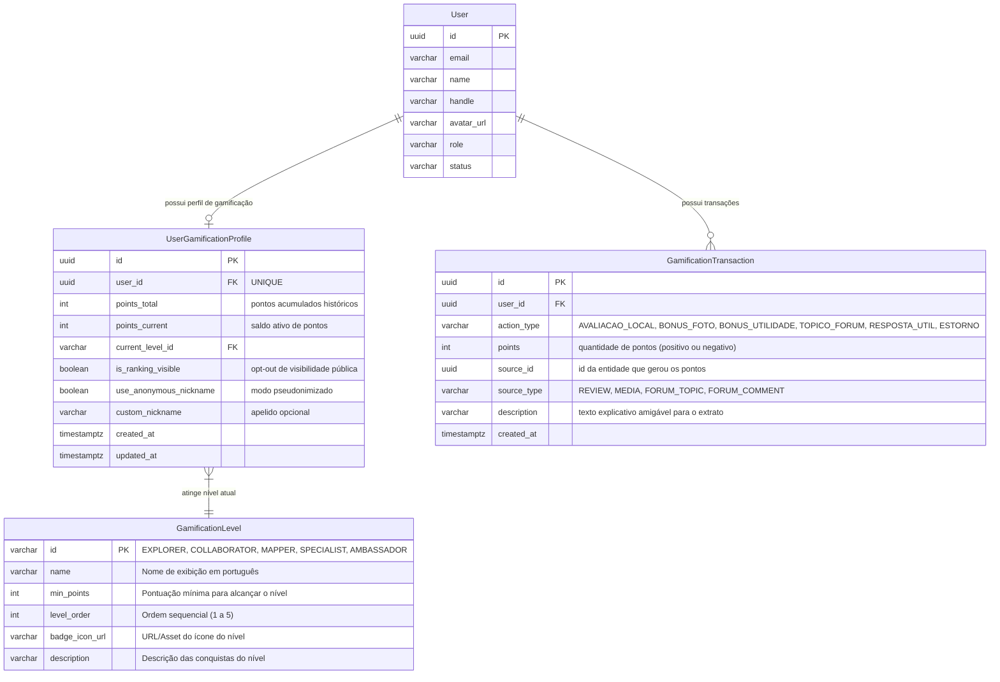

# Data Model: Sistema de Gamificação (Pontuação e Ranking)

**Feature**: `003-gamificacao-pontos-ranking`  
**Date**: 2026-11-05  
**Spec Reference**: [spec.md](./spec.md)

---

## 1. Diagrama de Relacionamento de Entidades (ERD)

---

## 2. Definição das Entidades e Regras de Validação

### `UserGamificationProfile`
Representa o estado consolidado da jornada de gamificação do usuário na plataforma.

| Campo | Tipo | Restrições | Descrição |
|---|---|---|---|
| `id` | UUID | PK, default uuid() | Identificador único do perfil de gamificação |
| `user_id` | UUID | FK -> `users(id)`, UNIQUE, NOT NULL | Vínculo com a conta do usuário |
| `points_total` | INTEGER | NOT NULL, DEFAULT 0, CHECK (>= 0) | Pontos totais acumulados historicamente (utilizados para cálculo de nível) |
| `points_current` | INTEGER | NOT NULL, DEFAULT 0, CHECK (>= 0) | Saldo de pontos atual |
| `current_level_id` | VARCHAR(50) | NOT NULL, DEFAULT 'EXPLORER' | Nível atual do usuário |
| `is_ranking_visible` | BOOLEAN | NOT NULL, DEFAULT true | Se `false`, o usuário fica oculto do ranking público (opt-out LGPD) |
| `use_anonymous_nickname`| BOOLEAN | NOT NULL, DEFAULT false | Se `true`, exibe pseudônimo em vez de nome real no ranking |
| `custom_nickname` | VARCHAR(50) | NULLABLE | Apelido configurado pelo usuário para exibição anônima |
| `created_at` | TIMESTAMPTZ | NOT NULL, DEFAULT now() | Data de inicialização do perfil |
| `updated_at` | TIMESTAMPTZ | NOT NULL, DEFAULT now() | Data da última atualização |

### `GamificationTransaction`
Registro imutável que audita cada ganho ou estorno de pontos.

| Campo | Tipo | Restrições | Descrição |
|---|---|---|---|
| `id` | UUID | PK, default uuid() | Identificador único da transação |
| `user_id` | UUID | FK -> `users(id)`, NOT NULL | Usuário beneficiário ou debitado |
| `action_type` | VARCHAR(50) | NOT NULL | Tipo da ação (enum textual) |
| `points` | INTEGER | NOT NULL | Quantidade de pontos concedidos (+ ou -) |
| `source_id` | UUID | NULLABLE | ID do recurso de origem (ex: review ID, tópico ID) |
| `source_type` | VARCHAR(50) | NULLABLE | Tipo do recurso de origem (`REVIEW`, `MEDIA`, `FORUM_TOPIC`, `FORUM_COMMENT`) |
| `description` | VARCHAR(255)| NOT NULL | Descrição acessível da transação para o extrato |
| `created_at` | TIMESTAMPTZ | NOT NULL, DEFAULT now() | Data e hora exata da concessão/estorno |

**Regra de Idempotência e Unicidade:**
- Índice único parcial ou composto em `(user_id, action_type, source_id)` para impedir que a mesma ação conceda pontos mais de uma vez ao mesmo usuário.

### `GamificationLevel`
Tabela estática/semente de níveis progressivos da plataforma.

| Nível / Chave | Nome de Exibição | Pontos Mínimos | Ordem | Descrição |
|---|---|---|---|---|
| `EXPLORER` | Explorador(a) Iniciante | 0 | 1 | Primeiros passos na comunidade DáPraIr? |
| `COLLABORATOR` | Colaborador(a) Ativo | 100 | 2 | Contribui regularmente com avaliações e dicas |
| `MAPPER` | Mapeador(a) de Acessibilidade | 300 | 3 | Referência em mapear locais acessíveis com fotos |
| `SPECIALIST` | Especialista Comunitário | 700 | 4 | Alto engajamento e apoio a outros membros |
| `AMBASSADOR` | Embaixador(a) da Acessibilidade | 1500 | 5 | Pilar da comunidade e guardião da acessibilidade |

---

## 3. Regras de Transição de Estado e Negócio

1. **Atribuição Automática**:
   - Criação de avaliação de local: verifica se o usuário já avaliou este local; se for a primeira vez válida, credita 15 pontos base.
   - Fotos anexadas na avaliação: para cada foto válida de acessibilidade (até 3 fotos), credita 10 pontos de bônus (`BONUS_FOTO`).
   - Avaliação marcada como Útil por terceiros: credita 25 pontos ao autor da avaliação (`BONUS_UTILIDADE`).
   - Tópico no fórum: credita 10 pontos (`TOPICO_FORUM`).
   - Resposta marcada como solução no fórum: credita 20 pontos (`RESPOSTA_UTIL`).
2. **Estorno (Rollback de Pontos)**:
   - Se uma avaliação for removida pelo autor ou excluída por moderação (denúncia procedente), é criada uma transação compensatória de valor negativo (`ESTORNO`), subtraindo os pontos do saldo atual e recalculando o nível se necessário.
3. **Limite Anti-Abuso (Teto Diário)**:
   - O sistema valida via consulta rápida de agregação diária se o usuário atingiu o limite de 150 pontos/dia em avaliações ou 50 pontos/dia no fórum. Ao atingir o teto, o conteúdo continua sendo salvo normalmente, mas nenhuma nova transação de pontos é emitida.
