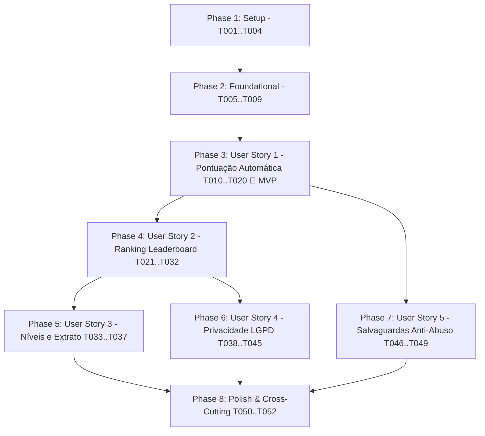

# Tasks: Sistema de Gamificação (Pontuação por Conteúdo e Ranking de Usuários)

**Input**: Design documents from `/specs/003-gamificacao-pontos-ranking/`  
**Prerequisites**: [plan.md](./plan.md) (required), [spec.md](./spec.md) (required), [data-model.md](./data-model.md), [contracts/openapi.yaml](./contracts/openapi.yaml), [research.md](./research.md), [quickstart.md](./quickstart.md)  

**Tests**: Tests are MANDATORY per Constitution (Principle III: Testabilidade Contínua e Alta Cobertura >= 80%). Every story includes unit tests, widget/accessibility tests (WCAG 2.1 AA), and integration/contract tests.

**Organization**: Tasks are grouped by user story to enable independent implementation and testing of each story.

## Format: `[ID] [P?] [Story] Description`

- **[P]**: Can run in parallel (different files, no dependencies)
- **[Story]**: Which user story this task belongs to (e.g., US1, US2, US3, US4, US5)
- Include exact file paths in descriptions

## Path Conventions

- **Full-stack Monorepo**: `backend/src/`, `backend/tests/`, `frontend/lib/`, `frontend/test/`

---

## Phase 1: Setup (Shared Infrastructure)

**Purpose**: Project initialization, database schemas, and shared infrastructure

- [X] T001 Create directory structure for gamification backend in `backend/src/modules/gamification/` and frontend in `frontend/lib/presentation/views/gamification/`, `frontend/lib/presentation/bloc/gamification/`, and `frontend/lib/presentation/components/`
- [X] T002 Update Prisma schema in `backend/prisma/schema.prisma` with `UserGamificationProfile`, `GamificationTransaction`, and `GamificationLevel` models, relational indexes, and user inverse relations
- [X] T003 [P] Generate Prisma Client and create versioned SQL migration in `backend/prisma/migrations/`
- [X] T004 [P] Update database seed script in `backend/prisma/seed.ts` with initial gamification levels (Explorer, Collaborator, Mapper, Specialist, Ambassador) and sample initial profiles

---

## Phase 2: Foundational (Blocking Prerequisites)

**Purpose**: Core validation schemas, domain contracts, and shared components that MUST be complete before ANY user story can be implemented

**⚠️ CRITICAL**: No user story work can begin until this phase is complete

- [X] T005 Implement Zod validation schemas for gamification queries (period, pagination) and privacy preferences in `backend/src/modules/gamification/gamification.schemas.ts`
- [X] T006 Create base domain entities in `frontend/lib/domain/entities/gamification_profile.dart`, `frontend/lib/domain/entities/leaderboard_entry.dart`, `frontend/lib/domain/entities/gamification_level.dart`, and `frontend/lib/domain/entities/gamification_transaction.dart`
- [X] T007 [P] Define abstract gamification repository contract in `frontend/lib/domain/repositories/gamification_repository.dart`
- [X] T008 [P] Implement reusable `LevelBadgeWidget` component with WCAG 2.1 AA high contrast (>= 4.5:1) in `frontend/lib/presentation/components/level_badge_widget.dart`
- [X] T009 Register gamification module route plugin in Fastify server in `backend/src/server.ts`

**Checkpoint**: Foundation ready - user story implementation can now begin in parallel

---

## Phase 3: User Story 1 - Pontuação Automática por Criação de Conteúdo (Priority: P1) 🎯 MVP

**Goal**: Atribuir pontos automaticamente e atomicamente ao usuário autenticado por criação de avaliações de acessibilidade (+15 base), fotos (+10 por foto válida, max 3), bônus de utilidade (+25) e fórum (+10 tópico, +20 resposta útil), registrando transações imutáveis e atualizando saldo.

**Independent Test**: Publicar uma avaliação com 2 fotos de acessibilidade ou criar um tópico no fórum com um usuário autenticado e verificar se o saldo é incrementado imediatamente (+35 ou +10 pts), gerando notificação acessível de confirmação e entrada no extrato.

### Tests for User Story 1 (MANDATORY - >= 80% coverage + Accessibility) ⚠️

> **NOTE: Write these tests FIRST, ensure they FAIL before implementation**

- [X] T010 [P] [US1] Unit tests for point awarding rules, idempotent transaction handling `(user_id, action_type, source_id)`, level recalculation, and point rollbacks in `backend/tests/unit/gamification.service.test.ts`
- [X] T011 [P] [US1] Integration tests for profile and transactions endpoints (`/api/v1/gamification/profile`, `/api/v1/gamification/transactions`) in `backend/tests/integration/gamification.routes.test.ts`
- [X] T012 [P] [US1] Unit and BLoC tests for gamification repository and BLoC in `frontend/test/unit/gamification_repository_test.dart` and `frontend/test/bloc/gamification_bloc_test.dart`
- [X] T013 [P] [US1] Widget and accessibility tests for `PointsCounterBanner` notification (verifying TalkBack/VoiceOver semantics) in `frontend/test/widget/points_counter_banner_test.dart`

### Implementation for User Story 1

- [X] T014 [US1] Implement gamification service core methods (`awardPoints`, `rollbackPoints`, `getUserProfile`, `getUserTransactions`) with Prisma atomic transactions in `backend/src/modules/gamification/gamification.service.ts`
- [X] T015 [US1] Integrate gamification points hooks into `backend/src/modules/reviews/reviews.service.ts` (upon review creation and photo attachments) and `backend/src/modules/forum/forum.service.ts` (upon topic creation and marked useful replies)
- [X] T016 [US1] Implement Fastify route handlers for user profile, levels catalog, and transactions history in `backend/src/modules/gamification/gamification.routes.ts`
- [X] T017 [P] [US1] Implement repository methods for gamification profile and transactions with Dio in `frontend/lib/data/repositories/gamification_repository_impl.dart`
- [X] T018 [US1] Implement `GamificationBloc`, events, and states for profile loading, points notification, and transactions stream in `frontend/lib/presentation/bloc/gamification/gamification_bloc.dart`, `frontend/lib/presentation/bloc/gamification/gamification_event.dart`, and `frontend/lib/presentation/bloc/gamification/gamification_state.dart`
- [X] T019 [P] [US1] Implement accessible `PointsCounterBanner` toast/snackbar notification component in `frontend/lib/presentation/components/points_counter_banner.dart`
- [X] T020 [US1] Register gamification repository dependency in `frontend/lib/main.dart` and inject points listener to trigger accessible banners on content actions

**Checkpoint**: At this point, User Story 1 is fully functional and testable independently as the core MVP engine!

---

## Phase 4: User Story 2 - Consulta ao Ranking de Usuários (Leaderboard) (Priority: P1)

**Goal**: Exibir o ranking de usuários (Leaderboard) ordenado de forma decrescente com alternância em tempo real entre abas de janelas temporais (Semanal, Mensal padrão e Geral), destacando a colocação ordinal do usuário logado e garantindo acesso ao visitante em modo convidado.

**Independent Test**: Acessar a tela de Ranking, alternar entre as abas Semanal, Mensal e Geral, verificar ordenação correta por pontos, conferir a barra fixa com o ranking do próprio usuário e validar leitura com leitor de tela (TalkBack/VoiceOver).

### Tests for User Story 2 (MANDATORY - >= 80% coverage + Accessibility) ⚠️

- [X] T021 [P] [US2] Unit tests for temporal leaderboard calculation (weekly cutoff, monthly cutoff, all-time query) and user rank relative distance computation in `backend/tests/unit/gamification.service.test.ts`
- [X] T022 [P] [US2] Integration tests for public leaderboard endpoint (`/api/v1/gamification/leaderboard?period=...`) for guests and authenticated users in `backend/tests/integration/gamification.routes.test.ts`
- [X] T023 [P] [US2] Widget and accessibility tests for `LeaderboardTile` and `RankingPeriodTabs` (verifying touch targets >= 48x48 dp, high contrast, and ordinal semantics "1º lugar") in `frontend/test/widget/leaderboard_tile_test.dart`

### Implementation for User Story 2

- [X] T024 [US2] Implement `getLeaderboard(period, page, limit, currentUserId)` query aggregation with date filtering and user rank resolution in `backend/src/modules/gamification/gamification.service.ts`
- [X] T025 [US2] Implement Fastify route handler for `/api/v1/gamification/leaderboard` in `backend/src/modules/gamification/gamification.routes.ts`
- [X] T026 [P] [US2] Implement repository method for fetching leaderboard by period with Dio in `frontend/lib/data/repositories/gamification_repository_impl.dart`
- [X] T027 [US2] Update `GamificationBloc` to handle leaderboard loading, pagination, and period tab switching in `frontend/lib/presentation/bloc/gamification/gamification_bloc.dart`
- [X] T028 [P] [US2] Implement accessible `LeaderboardTile` component with position medal icon, text ordinal ("1º"), user avatar, name/nickname, points, and level badge in `frontend/lib/presentation/components/leaderboard_tile.dart`
- [X] T029 [P] [US2] Implement accessible `RankingPeriodTabs` segmented tab component with >= 48x48 dp targets in `frontend/lib/presentation/components/ranking_period_tabs.dart`
- [X] T030 [P] [US2] Implement accessible `UserRankStickyBar` component displaying the current user's rank and points to next position in `frontend/lib/presentation/components/user_rank_sticky_bar.dart`
- [X] T031 [US2] Implement `LeaderboardView` with pull-to-refresh, empty states, and guest-mode banner in `frontend/lib/presentation/views/gamification/leaderboard_view.dart`
- [X] T032 [US2] Add Leaderboard tab or button entry in main navigation in `frontend/lib/presentation/views/home/main_navigation_screen.dart`

**Checkpoint**: User Stories 1 and 2 are fully integrated, providing an end-to-end gamified loop of content creation and competitive leaderboard browsing.

---

## Phase 5: User Story 3 - Níveis de Engajamento, Insígnias e Extrato de Conquistas (Priority: P2)

**Goal**: Permitir que usuários acompanhem sua evolução através de níveis hierárquicos (Explorador a Embaixador), visualizem badges de conquistas desbloqueadas e consultem o extrato cronológico detalhado de pontuações e estornos.

**Independent Test**: Simular acúmulo de pontos que ultrapasse o limiar de um novo nível (ex: 100 pontos para Colaborador), verificar atualização do título/badge no perfil do usuário e conferir todas as entradas e motivos no extrato de transações.

### Tests for User Story 3 (MANDATORY - >= 80% coverage + Accessibility) ⚠️

- [X] T033 [P] [US3] Unit tests for level threshold progression, level promotion detection, and transaction history pagination in `backend/tests/unit/gamification.service.test.ts`
- [X] T034 [P] [US3] Widget and accessibility tests for profile view, progress bar to next level, and transaction tile in `frontend/test/widget/gamification_profile_view_test.dart`

### Implementation for User Story 3

- [X] T035 [US3] Implement level promotion check and next level calculation logic in `backend/src/modules/gamification/gamification.service.ts`
- [X] T036 [P] [US3] Implement `GamificationProfileView` with progress bar toward next level, badges showcase, and paginated transaction history list in `frontend/lib/presentation/views/gamification/gamification_profile_view.dart`
- [X] T037 [US3] Integrate navigation link to `GamificationProfileView` from user profile screen in `frontend/lib/presentation/views/profile/user_profile_view.dart`

---

## Phase 6: User Story 4 - Privacidade, Consentimento e Anonimato no Ranking (LGPD) (Priority: P2)

**Goal**: Garantir conformidade com a LGPD permitindo que o usuário alterne entre exibição com nome público/apelido padrão (opt-out), modo pseudonimizado ("Usuário Anônimo") ou ocultação total do ranking público, assegurando anonimização imediata em caso de exclusão de conta.

**Independent Test**: Alterar a opção de privacidade para "Ocultar do Ranking Público" e verificar se o usuário desaparece da listagem do leaderboard; alterar para "Modo Anônimo" e verificar se o nome é substituído pelo pseudônimo, mantendo o saldo privado intacto.

### Tests for User Story 4 (MANDATORY - >= 80% coverage + Accessibility) ⚠️

- [X] T038 [P] [US4] Unit tests for privacy settings updates, filtering hidden users from leaderboard queries, and pseudonymization logic in `backend/tests/unit/gamification.service.test.ts`
- [X] T039 [P] [US4] Integration tests for preferences endpoint (`PUT /api/v1/gamification/preferences`) and deleted user anonymization in `backend/tests/integration/gamification.routes.test.ts`
- [X] T040 [P] [US4] Widget and accessibility tests for privacy settings toggles (verifying WCAG 2.1 AA screen reader semantics) in `frontend/test/widget/gamification_privacy_view_test.dart`

### Implementation for User Story 4

- [X] T041 [US4] Implement `updatePrivacyPreferences` and account deletion hook (anonymizing gamification profile on user deletion) in `backend/src/modules/gamification/gamification.service.ts`
- [X] T042 [US4] Implement Fastify route handler for `PUT /api/v1/gamification/preferences` in `backend/src/modules/gamification/gamification.routes.ts`
- [X] T043 [P] [US4] Implement repository method for updating gamification privacy preferences with Dio in `frontend/lib/data/repositories/gamification_repository_impl.dart`
- [X] T044 [P] [US4] Implement accessible `GamificationPrivacyView` with switch toggles for visibility and custom nickname input in `frontend/lib/presentation/views/gamification/gamification_privacy_view.dart`
- [X] T045 [US4] Link gamification privacy settings into main privacy settings screen in `frontend/lib/presentation/views/profile/privacy_settings_view.dart`

---

## Phase 7: User Story 5 - Salvaguardas Anti-Abuso e Limites Diários de Pontuação (Priority: P3)

**Goal**: Impedir abusos, spam ou fraudes na concessão de pontos através de limites máximos diários por categoria (ex: máx 150 pts/dia em avaliações e 50 pts/dia no fórum) e restrição de pontuação para estabelecimentos duplicados.

**Independent Test**: Submeter mais de 10 avaliações no mesmo dia com o mesmo usuário e verificar se, após atingir 150 pontos diários, as avaliações seguintes continuam sendo salvas sem atribuir novos pontos, exibindo feedback informativo amigável.

### Tests for User Story 5 (MANDATORY - >= 80% coverage) ⚠️

- [X] T046 [P] [US5] Unit tests for daily category point caps, duplicate establishment checks, and rate-limiting rules in `backend/tests/unit/gamification.service.test.ts`
- [X] T047 [P] [US5] Integration tests verifying that submissions above daily caps succeed without awarding extra points in `backend/tests/integration/gamification.routes.test.ts`

### Implementation for User Story 5

- [X] T048 [US5] Implement daily point cap validation query and duplicate establishment check before executing point transaction in `backend/src/modules/gamification/gamification.service.ts`
- [X] T049 [US5] Update reviews and forum integration handlers to return informative cap messages to the client in `backend/src/modules/reviews/reviews.service.ts` and `backend/src/modules/forum/forum.service.ts`

---

## Phase 8: Polish & Cross-Cutting Concerns

**Purpose**: High-contrast theme validation, comprehensive accessibility audits, end-to-end integration tests, and performance benchmark.

- [X] T050 [P] Run and verify end-to-end test suite coverage (minimum 80% coverage check across backend and frontend) via `npm run test` and `flutter test`
- [X] T051 [P] Accessibility audit (WCAG 2.1 AA) verifying color contrast ratios (>= 4.5:1), touch targets (>= 48x48 dp), and screen reader announcements in `frontend/test/widget/accessibility_gamification_audit_test.dart`
- [X] T052 Performance verification verifying leaderboard queries under load (P95 < 120ms with index verification) in `backend/tests/integration/gamification_performance.test.ts`

---

## Dependencies & Execution Order

