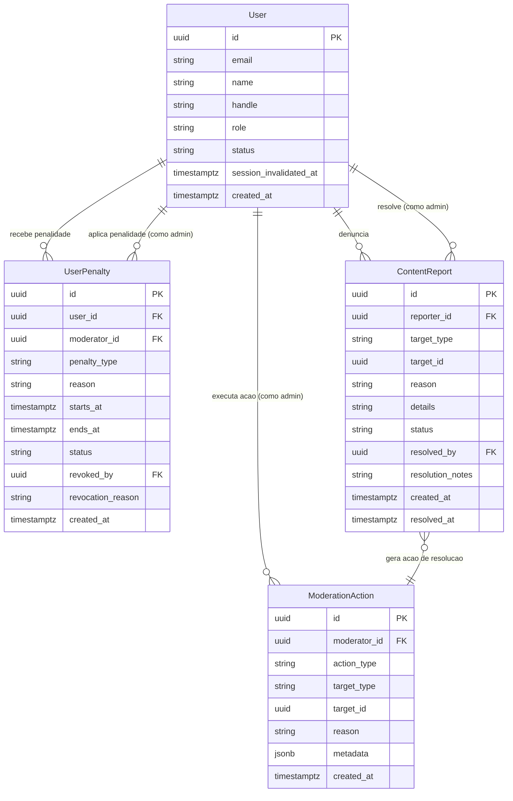
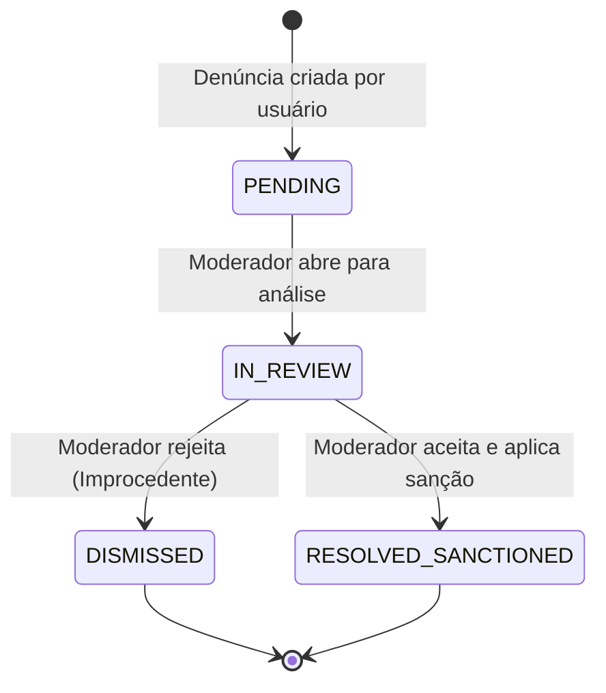
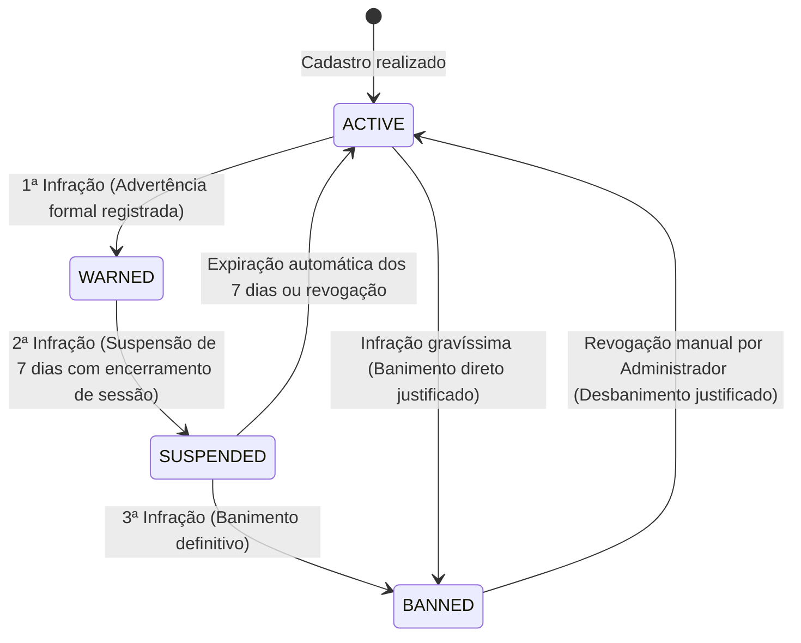
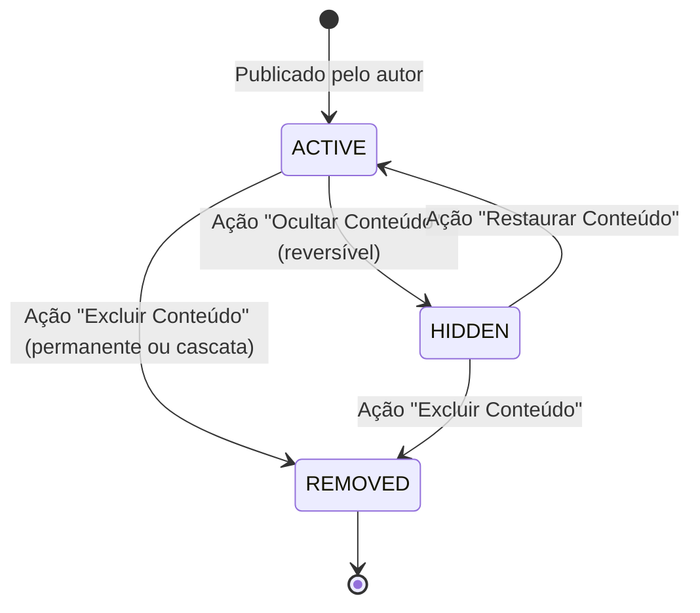

# Data Model: Painel de Controle Administrativo e Moderação

**Feature Branch**: `004-admin-moderation-panel`  
**Date**: 2026-11-05  
**Spec Reference**: [spec.md](./spec.md) | **Research**: [research.md](./research.md)  

Este documento descreve as entidades de dados, relações, esquemas Prisma em PostgreSQL e máquinas de estado necessárias para suportar a funcionalidade de moderação e administração do DáPraIr?.

---

## 1. Diagrama de Relacionamento de Entidades (ERD)



---

## 2. Entidades e Modelos do Banco de Dados

### 2.1 Atualização no Modelo `User`

Adição do controle de invalidação de sessão e novos status:

```prisma
model User {
  // ... campos existentes ...
  status                 String    @default("ACTIVE") @db.VarChar(20) // ACTIVE, WARNED, SUSPENDED, BANNED, DELETED
  session_invalidated_at DateTime? @db.Timestamptz

  // Relações de moderação
  penalties_received   UserPenalty[]      @relation("UserPenaltiesReceived")
  penalties_issued     UserPenalty[]      @relation("AdminPenaltiesIssued")
  moderation_actions   ModerationAction[] @relation("AdminModerationActions")
  // ... outras relacoes existentes ...
}
```

### 2.2 Entidade `UserPenalty` (`user_penalties`)

Registra o escalonamento progressivo de advertências e banimentos:

```prisma
model UserPenalty {
  id                 String    @id @default(uuid()) @db.Uuid
  user_id            String    @db.Uuid
  moderator_id       String    @db.Uuid
  penalty_type       String    @db.VarChar(30) // WARNING, SUSPENSION_7_DAYS, PERMANENT_BAN
  reason             String    @db.Text
  starts_at          DateTime  @default(now()) @db.Timestamptz
  ends_at            DateTime? @db.Timestamptz // Preenchido com starts_at + 7 dias se SUSPENSION_7_DAYS, null se PERMANENT_BAN ou WARNING
  status             String    @default("ACTIVE") @db.VarChar(20) // ACTIVE, EXPIRED, REVOKED
  revoked_by         String?   @db.Uuid
  revocation_reason  String?   @db.Text
  created_at         DateTime  @default(now()) @db.Timestamptz

  user       User  @relation("UserPenaltiesReceived", fields: [user_id], references: [id], onDelete: Cascade)
  moderator  User  @relation("AdminPenaltiesIssued", fields: [moderator_id], references: [id], onDelete: Restrict)
  revoker    User? @relation("AdminPenaltiesRevoked", fields: [revoked_by], references: [id], onDelete: SetNull)

  @@index([user_id, status])
  @@index([status, ends_at])
  @@map("user_penalties")
}
```

### 2.3 Atualização no Modelo `ContentReport` (`content_reports`)

Expansão dos tipos suportados de alvos denunciáveis e status de resolução:

```prisma
// target_type suporta: FORUM_TOPIC, FORUM_COMMENT, PLACE_REVIEW, PLACE_MEDIA, USER, MESSAGE, EVENT
// reason suporta: INACCURATE_DATA, INAPPROPRIATE_MEDIA, HARASSMENT, SPAM, HATE_SPEECH, ACCESSIBILITY_MISINFORMATION, OTHER
// status suporta: PENDING, IN_REVIEW, RESOLVED_SANCTIONED, DISMISSED
```

### 2.4 Entidade `ModerationAction` (`moderation_actions`)

Log de auditoria imutável para governança e LGPD:

```prisma
model ModerationAction {
  id           String   @id @default(uuid()) @db.Uuid
  moderator_id String   @db.Uuid
  action_type  String   @db.VarChar(40) // HIDE_CONTENT, RESTORE_CONTENT, DELETE_CONTENT, WARN_USER, SUSPEND_USER, BAN_USER, UNBAN_USER, DISMISS_REPORT, RESOLVE_REPORT
  target_type  String   @db.VarChar(30) // FORUM_TOPIC, FORUM_COMMENT, PLACE_REVIEW, PLACE_MEDIA, USER, REPORT
  target_id    String   @db.Uuid
  reason       String   @db.Text
  metadata     Json?    // Snapshot de título/conteúdo original, quantidade de itens afetados em cascata, etc.
  created_at   DateTime @default(now()) @db.Timestamptz

  moderator User @relation("AdminModerationActions", fields: [moderator_id], references: [id], onDelete: Restrict)

  @@index([target_type, target_id])
  @@index([moderator_id, created_at(sort: Desc)])
  @@index([action_type, created_at(sort: Desc)])
  @@map("moderation_actions")
}
```

---

## 3. Máquinas de Estados e Transições

### 3.1 Ciclo de Vida da Denúncia (`ContentReport`)



### 3.2 Escalonamento de Penalidades do Usuário (`User`)



### 3.3 Ciclo de Moderação do Conteúdo (`ModeratedContent`)



---

## 4. Regras de Validação de Dados

1. **Justificativa Obrigatória de Moderação**: Toda ação de moderação (ocultar, excluir, advertir, suspender, banir) exige um motivo textual com comprimento mínimo de 10 caracteres.
2. **Dupla Confirmação de Exclusão**: A exclusão definitiva exige parâmetro explícito de confirmação (`confirm: true`), prevenindo acionamentos acidentais.
3. **Imutabilidade de Auditoria**: Registros na tabela `moderation_actions` nunca devem receber comandos de atualização (`UPDATE`) ou deleção (`DELETE`).
